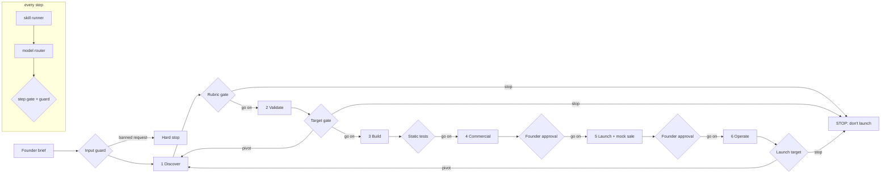

# Architecture

## Overview

A deterministic Python state machine (`app/orchestrator.py`) walks a founder's brief through six phases. Each
step is a **skill** in `config/skills.yaml`, owned by one of six agent teams. For example, the Researcher team
owns the Idea Sharpener, Opportunity Scorer, Market Researcher and Interview Coach.

A step's system prompt has three layers: shared rules (`prompts/skills/_common.md`), the team's role
(`prompts/<team>.md`) and the step task (`prompts/skills/<skill>.md`). One generic skill runner
(`app/skill_runner.py`) makes the model call. Each team module (`app/agents/<team>.py`) adds the code that runs
before or after its steps. A separate critic (`app/agents/critic.py`, `prompts/critic.md`) reads every outgoing
item.

Models never choose the next step. After each step a **step gate** checks the artifact, and at the end of each
phase a **phase gate** recommends go on, repeat, pivot or stop. The founder decides at every phase gate.
Anything outgoing needs the founder's approval token before it reaches the outbox. All state lives in
`runs/<id>/state.json`; every agent action is appended to `decision_log.json`, and each artifact is written to
`outputs/phase<N>_step<M>_<name>.md`.

| Team (`app/agents/`) | Phase | Agents | Code it owns |
|---|---|---|---|
| `researcher.py` | 1 Discover | Idea Sharpener, Opportunity Scorer, Market Researcher, Interview Coach | none; scored by the Discover gate |
| `validator.py` | 2 Validate | Business Modeler, Test Designer, Landing Page Writer, Results Analyst, Interview Analyst | logs the target before any evidence; skips interview analysis when there are no notes; checks interview counts |
| `builder.py` | 3 Build | Product Spec Writer, Product Builder, Docs Writer | spec file normalizing, static tests, writing the pack |
| `commercial.py` | 4 Commercial setup | Pricing Analyst, Policy Drafter | none; founder approval gate |
| `launcher.py` | 5 Sell, deliver, get paid | Store Page Writer, Launch Writer, Order Simulator | runs the sale-to-cash flow on the mocked ledger |
| `operator.py` | 6 Operate and learn | Support Writer, Metrics Analyst, Strategy Advisor | none; target gate |
| `critic.py` | all outgoing items | Critic | second-opinion safety read, fails closed |



## Phases

Every step works the same way: the input guard, then web search (results wrapped as untrusted data), then the
model call, which must return JSON `{body_md, claims, data}`. All roles run at temperature 0. Then come the
accuracy checks, all in code (`app/evidence.py`):

- **Source support:** a sourced claim stays sourced only if its URL came from this run's searches *and* that
  result's title or snippet shares the claim's key words. Otherwise it is downgraded to `ASSUMPTION`, with the
  reason and how to verify it.
- **One set of numbers:**
  - Break-even sales are computed as fixed costs ÷ (price − cost per sale), never taken from the model.
  - The price is the recommended price once Pricing has run.
  - The canvas and pricing must cover the cost per sale, and the store page must show the recommended price.
  - A mismatch fails the step gate.

After that come the output guard and the step gate. A failed step is repeated once, then escalated to the
founder.

Each phase below names its **core step** from the problem statement, then the agents, tools, method, the code
checks around the model, the gate, and the files it writes. Steps run in the order shown (`PHASE_STEPS` in
`app/state.py`); each step's agent, model role, searches and context are in `config/skills.yaml`.

### Phase 1 Discover

**Core step: Find opportunities.** Sharpen the founder's idea, score it against alternatives, define the market,
and prepare the customer interviews (The Mom Test).

- **Agents (Researcher team, `app/agents/researcher.py`, `prompts/researcher.md`):** Idea Sharpener, Opportunity
  Scorer, Market Researcher, Interview Coach.
- **Tools:**
  - SearXNG (self-hosted in compose), falling back to Hacker News, GitHub and StackExchange.
  - Broadened query variants when a long query finds nothing.
  - Results are cached per query for the day (`runs/search_cache/`), so re-running a brief sees the same evidence
    and gets a comparable score; search engines otherwise reorder results from one run to the next.
  - Search terms are grounded in the founder's own words. The Idea Sharpener proposes 3-5 key words; code keeps only
    words found in the idea text, and with fewer than two it picks them itself, skipping filler such as "I'm thinking of
    building a tool that". A model cannot steer the search to a different idea.
- **Method:**
  1. **Sharpen idea:** three concrete variants (who, problem, offer) and the best fit. Checks the founder's
     budget, time and skills (`fits_constraints`; only this agent decides fit) and flags excluded categories.
  2. **Score alternatives:**
     - The best-fit option from step 1 (the first version, not every feature mentioned) and 2 alternatives are scored 0–1 on founder fit, demand signal, competition and time to MVP,
       using written definitions for every level.
     - The scorer sees the customer-problem and complaint searches too, so demand is judged on them.
     - Founder hours are spelled out in code (10 h/week = 20 h in 2 weeks, 60 h in 6 weeks), so no model reads
       "10 hours per week" as 10 hours in total; founder fit scores skills and values only.
     - Competitors are listed only from search results, each with its URL. Paid products already sold to these
       customers count as demand evidence (people pay for a fix), even though they also lower competition.
  3. **Define market:** first customers, their problem and where they gather, from "customers problem" and
     "complaints" searches.
  4. **Interview script:** Mom Test questions about past behaviour, with no pitching and no leading questions.
- **Code checks:** claims are kept only when the cited snippet supports them; demand is capped by the number of
  supported market sources.
- **Gate:**
  - **Hard stops (no override):** excluded category, or no sources at all (cannot assess).
  - **STOP:**
    - the idea doesn't fit the founder;
    - the weighted score is below 60;
    - demand is below the 0.5 floor, even when the total passes.
  - **Report:** the gate shows the score breakdown and flags borderline scores (±5).
  - **Strongest case against (every outcome, even GO ON):** built in code from this run's evidence: the two
    weakest scores, the closest competitors found with their URLs, and how many Discover claims are still
    assumptions.
  - **Why, in plain words:** every score under 0.5 is named with its reason (for example "several close
    alternatives already serve these customers"), next to 2-3 concrete changes the scorer suggests.
  - **Pivot = edit the idea:** at this gate a pivot means editing the idea (for example with a suggested change);
    Discover then runs again from step 1 on the new idea. A pivot with an unchanged idea is refused, since the
    same idea on the same evidence only repeats the verdict. The old Discover work is kept but marked rejected,
    the change is logged, the new idea passes the same guard as the brief, and the repeat limit applies. A pivot
    from a later gate (Validate, Operate) also takes the edited idea before Discover re-runs.
- **Output:** `phase1_step1_opportunities.md` … `phase1_step4_interview_script.md`, `phase1_gate_decision.md`.

### Phase 2 Validate

**Core step: Design the business.** A Lean Canvas, then a demand test with a landing page, judged against a
target set beforehand, plus customer interviews.

- **Agents (Validator team):** Business Modeler, Test Designer, Landing Page Writer, Interview Analyst; results
  come from the founder.
- **Method:**
  1. **Lean canvas:** the nine boxes plus price, cost per sale and fixed costs. Unsourced numbers are labelled
     ASSUMPTION.
  2. **Set target:** one measurable target (for example sign-ups in 7 days), tied to break-even. It is logged
     as a `Target` before any evidence exists; the gate checks that order.
  3. **Landing page:**
     - Honest copy, with no invented users or reviews.
     - It is outgoing, so it passes the guard, a critic model, and founder approve/reject.
     - It then goes to `outbox/` (MOCKED; nothing is published).
  4. **Enter results:**
     - The founder types the real number, logged as `founder_reported`.
     - Optional interview notes are added here.
     - Text is guard-checked and numbers must be 0 or more.
  5. **Analyze interviews:**
     - Each interview is tagged once: spending, past behaviour, compliment only, or not a problem.
     - Code checks that the counts add up.
     - With no notes the step is skipped without a model call.
- **Code checks:** break-even = fixed costs ÷ (price − cost per sale), computed in code; the canvas price must
  exceed the cost per sale.
- **Gate:**
  - **By the number:** 100% of target or more → go on; 50–99% → repeat; under 50% → STOP.
  - **Interviews can overturn it:**
    - target met but under 30% real evidence → repeat (curiosity sign-ups);
    - target missed but 60%+ real pain from 5+ interviews → pivot back (right problem, wrong offer).
  - Example from the problem statement: a target of 100 sign-ups with 12 received → STOP, unless interviews
    show real pain.
  - **Assumptions register:** at this gate, code collects every claim from Discover and Validate that is still an
    ASSUMPTION (not sourced, not entered by the founder), once each and with how to verify it. It is the list the
    next experiment should test.
- **Output:** `phase2_step1_lean_canvas.md` … `phase2_step5_interview_evidence.md`, `phase2_gate_decision.md`,
  `phase2_gate_assumptions_register.md`.

### Phase 3 Build

**Core step: Build the product.** Ship a tested MVP with user docs.

- **Agents (Builder team):** Product Spec Writer, Product Builder, Docs Writer.
- **Method:**
  1. **Spec:**
     - 5 acceptance criteria and a list of 3–4 files.
     - Only text types the builder can produce; a requested `.pdf`/`.docx` is renamed to `.md` in code.
  2. **Build:** the builder writes every file in the spec as finished content: guides, templates, CSV trackers.
  3. **Static tests (code, no model):**
     - every spec file is present;
     - file names are safe;
     - prose has at least 20 words and a CSV has a header plus 3 rows;
     - no placeholder text and no never-rule breaks.
     - Only a passing pack is written to `runs/<id>/product/`.
  4. **User docs:** how to use the pack.
- **Gate:** tests pass → go on; fail → repeat the build; still failing after repeated attempts → stop.
- **Output:** `phase3_step1_spec.md`, `phase3_step2_product_pack.md`, `phase3_step3_user_docs.md`,
  `phase3_gate_decision.md`.

### Phase 4 Commercial setup

**Core step: Set the price and policies.** Pricing and draft terms, privacy and refund policies, with no payments
of any kind.

- **Agents (Commercial team):** Pricing Analyst, Policy Drafter.
- **Method:**
  1. **Pricing:**
     - Price benchmark, built in code before the model runs. Code opens up to 6 competitor listings found by search
       (Gumroad, Etsy, Payhip and similar) and reads the price each declares in its structured product tags; a
       blocked page gives no price, never a guess. The benchmark holds only product prices: declared listing prices and
       prices in marketplace product-page snippets (article figures such as hourly rates or revenues are skipped),
       with its URL, marked one-time or recurring, plus min, median and max of the one-time prices
       (`evidence.extract_prices`). Written to `phase4_step1_price_benchmark.md` and logged with its sources.
     - Low, mid and high options, placed against that benchmark (each competitor price cited by its URL) and
       the unit economics. With no prices found, the options are labelled assumptions.
     - One recommended price, which then becomes the single price used everywhere (`evidence.economics`).
  2. **Policies:**
     - Plain-language terms, privacy and refund drafts, marked "Research, not legal advice".
     - The refund terms match what delivery enforces: a refund revokes access.
- **Code checks:** the recommended price must cover the cost per sale, and must not be a gross outlier (under a
  quarter or over four times the competitor median) without the step being retried.
- **Gate:** founder approval of both items. The code refuses to go on while any item is pending.
- **Output:** `phase4_step1_price_benchmark.md`, `phase4_step1_pricing.md`, `phase4_step2_policies.md`, `phase4_gate_decision.md`.

### Phase 5 Launch

**Core step: Open the store; deliver automatically.** Store page, launch posts, and automatic delivery to buyers
(MOCKED).

- **Agents (Launcher team):** Store Page Writer, Launch Writer, Order Simulator.
- **Method:**
  1. **Store page:**
     - Title, contents, the recommended price, and the refund summary.
     - No ratings, testimonials, sales counts or countdowns.
     - Code checks that the page shows the recommended price.
  2. **Launch posts:** in the founder's own plain voice.
  3. **Path for both:** guard, then critic model (fails closed), then founder approve/reject (single-use token
     tied to a content hash), then `outbox/` only (MOCKED).
  4. **Mock sale (code first, then the model writes it up):**
     - a mock order;
     - automatic delivery of one download link;
     - a second delivery attempt gets the same link (idempotent);
     - a mock refund revokes access;
     - reconciliation.
- **Gate:** founder approval of every outgoing item.
- **Output:** `phase5_step1_store_page.md`, `phase5_step2_launch_posts.md`, `phase5_step3_sale_to_cash.md`,
  `payment_test_log.md`, `phase5_gate_decision.md`.

### Phase 6 Operate and learn

**Core step: none in the problem statement.** Support, metrics, and a persevere-or-pivot memo.

- **Agents (Operator team):** Support Writer, Metrics Analyst, Strategy Advisor.
- **Method:**
  1. **Support FAQ:** from the spec and the policies.
  2. **Metrics and funnel:**
     - The founder enters real sales, and optionally store page visits and checkouts started.
     - Code computes each conversion rate and names the one stage that lost buyers (`evidence.funnel`):
       - **reach:** the visitors who came bought at or above the benchmark, but there were too few. It also gives the visits needed at that rate.
       - **checkout:** people started paying but stopped. Test the price or the checkout.
       - **page:** visitors did not start checkout. Change the promise, the page or the channel.
     - The benchmarks (1% visit-to-sale, 50% checkout completion) are ASSUMPTIONS in `config/gates.yaml`.
     - Impossible numbers (more sales than checkouts, more checkouts than visits) are refused.
  3. **Persevere or pivot:**
     - A memo that compares the sales with the launch target (given to the model with the unit economics).
     - It recommends persevere, pivot or stop, and lists the assumptions tested and the next 30 days.
- **Launch target:**
  - Logged when the phase starts, before any sales.
  - It is the larger of break-even and the sales that pay the founder's hours over 4 weeks at their hourly
    value (default $10/h, ASSUMPTION).
- **Gate:** the same thresholds as Validate (go on / repeat / STOP or pivot). Its reason adds the drop-off
  diagnosis, which the memo must follow rather than contradict.
- **Output:** `phase6_step1_support_faq.md` … `phase6_step3_persevere_or_pivot.md`, `phase6_gate_decision.md`.

## Gates

| Gate | Checks | Outcomes |
|---|---|---|
| Step (every step) | artifact present, output guard, claims sourced or `ASSUMPTION`, numbers consistent | go on / repeat once / escalate to the founder |
| 1 Discover | allowed category, sources retrieved, fits constraints, rubric score ≥ 60 (weights 30/30/20/20, written anchors per level), demand capped by supported market sources (0 → 0.2, 1 → 0.5) and must reach a floor of 0.5 even when the total passes (fit and speed are not demand); shows the score breakdown and flags ±5 as borderline | go on / repeat / **stop** / cannot assess |
| 2 Validate | as below, plus Mom Test interviews (`config/gates.yaml` `interviews`): target met but under 30% past behaviour or spending → **repeat** (curiosity sign-ups); target missed but 60%+ real pain from 5+ interviews → **pivot back** (wrong offer, real problem) | go on / repeat / pivot back / stop |
| 2 Validate, 6 Operate | target set before evidence; actual ÷ target (Phase 6 target = the larger of break-even and the sales that pay the founder's hours over 4 weeks at their hourly value, default $10/h ASSUMPTION) | ≥ 100% go on; 50–99% repeat; < 50% **stop** or pivot |
| 3 Build | static tests on the product pack | go on / repeat / stop after repeated failures |
| 4, 5 Commercial, Launch | every outgoing item approved by the founder | go on only when all are approved; repeat if one was rejected |

**When it recommends STOP:**

- **Score below 60 or idea doesn't fit:** a rubric score under 60, or an idea that does not fit the founder's
  constraints. Example: the `weak_idea` brief (a generic to-do app, no skills, 2 h/week) stops at Discover.
- **No evidence, or a big miss:** no results were entered, or the results fall below half the target.
- **Excluded category:** this is a **hard stop**, and the code refuses any override.

**What the founder can do at a gate:**

- **Choice:** the founder chooses go on, repeat, pivot (back to scoring alternatives) or stop.
- **Overrides:** going on against a stop needs a written reason, which is logged.
- **Approval phases:** in phases 4 and 5 the code refuses to go on until a fresh gate shows every item approved.
- **Repeat limit:** a 4th repeat stops the run (`max_repeats: 3` in `config/gates.yaml`).

## Sale to cash

`mock_sale` drives the real modules against a JSON ledger (`runs/ledger.json`). No real money moves, and every
record is labelled MOCKED.

- **Payment triggers delivery:** `payments.mock_order(key, price)` records a paid order, and
  `delivery.deliver(key)` issues one download link.
- **Idempotency:** a repeated `mock_order` or `deliver` with the same order key returns the same order and link,
  so there is no double charge and no second delivery. The test checks `second_delivery_same_link`.
- **Refund revokes access:** `refunds.mock_refund(key)` marks the order refunded, and `delivery.has_access`
  then returns false.
- **Reconciliation:** `reconcile.reconcile()` matches each order with its payments, fees, refunds, deliveries
  and payout.
  - **Real money:** must be zero, because nothing moves in the mocked flow.
  - **Payout due:** computed for each order as gross − fee − refund. The fee is an ASSUMPTION of 5% + $0.30, so
    the founder sees the unit economics, including that a refunded sale still costs the fee.
  - **Flags:** double delivery, a paid order never delivered, money appearing in the mocked flow, or a payout
    that doesn't add up.
  - **Output:** totals go to `outputs/payment_test_log.md`.

## Data flow

```
brief ─► input guard ─► orchestrator ─► skill runner ─► search (SearXNG / fallbacks) ─► <untrusted> block
                             │                └──► router ─► allowlisted open-weight model (or replay/)
                             │                         ▼
                             │                 JSON artifact ─► claim check ─► output guard ─► step gate
                             ▼
       runs/<id>/state.json  ·  decision_log.json  ·  outputs/phase<N>_step<M>_*.md
                             ▼
     outgoing item ─► critic second opinion ─► founder approve/reject (token = content hash) ─► outbox/ (MOCKED)
```

Founder actions (decisions, approvals, entered results) reach the orchestrator through the CLI or the FastAPI app
(`app/main.py`), which validates run ids and escapes model text on the page.

## Built vs. stubbed

| Part | State |
|---|---|
| Orchestrator, gates, guard, approval tokens, decision log | Built |
| Model router: allowlist, budgets, rate-limit fallback | Built |
| Web search, with SearXNG in compose | Built |
| Product file pack and static tests | Built |
| Landing page, store page and launch post publishing | MOCKED (outbox folder) |
| Payment, delivery, refund | MOCKED (local ledger) |
| Reconciliation | Built, running on mocked data |
| Real customer results and sales | Entered by the founder |
| Running without a key | STUBBED (replay recordings) |

## Roadmap

1. Export the approved store page, product pack and policies as a bundle the founder uploads to their own
   store themselves. The system keeps mocking payments and never adds payment code of any kind, not even
   sandbox; reconciliation can import the founder's own sales export as founder-reported numbers.
2. Local models through Ollama as a router provider.
3. More product types (Notion templates, short courses) as new skills.
4. A web form for interview notes, so Validate can score real qualitative evidence.
5. Community skill packs: YAML plus prompt, with no orchestrator changes.
6. Deeper Discover and Validate intake: target market defaulting to the founder's location, customer access,
   business objective, uploaded evidence; screening of more alternatives; outputs that depend on a changed
   answer re-run automatically.
7. Build produces a runnable MVP (a single-page web app for software ideas) with tests that execute.
